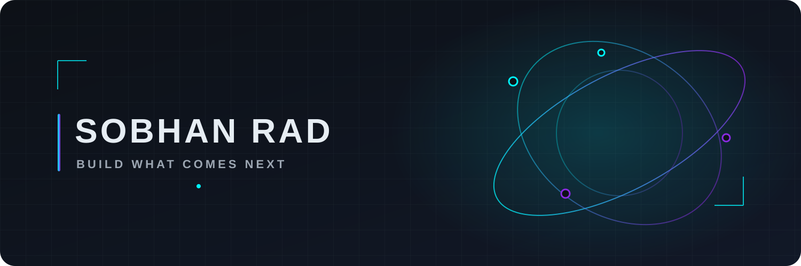

  

**Language / زبان:** 🇺🇸 [English](README.md) | 🇮🇷 [فارسی](README.fa.md)

---
<h1 align="center">Sobhan Rad</h1>

<strong>Independent Technology Enthusiast · Aspiring Software Developer · AI Explorer · Future Builder</strong>

<em>“I don’t just use technology. I build what comes next.”</em>

<code>AI &amp; intelligent systems</code> &nbsp; <code>software experiments</code> &nbsp; <code>useful tools</code>

---

## About me

I’m drawn to the space where software, artificial intelligence, and practical ideas meet. I like understanding how things work, trying unfamiliar tools, and learning by making—not just by reading about what might be possible.

I’m exploring AI-powered development, intelligent agents, automation, software customization, and open source. My aim is to turn curiosity into small, useful experiments and to get better through the process: ask good questions, build a first version, learn from what breaks, and improve it.

## What I’m curious about

**AI and LLM-powered applications** — Finding practical ways to make language models useful, understandable, and grounded in real needs.

**Agents, developer tools, and automation** — Exploring how software can assist with multi-step work and make everyday workflows more effective.

**Software and customization** — Learning how applications fit together and how thoughtful changes can make them more useful.

**Open source and product experiments** — Studying how people build in the open, test ideas, and shape rough prototypes into tools others can use.

## Current exploration

These are areas of exploration, not claims of completed projects:

- Practical applications of AI and language models.
- AI-assisted development workflows and small automations.
- Customizing software to solve concrete problems.
- Prototyping ideas and learning from experiments.
- Building useful tools with a clear purpose.

## Technologies I’m exploring

No verified technology stack was available in this workspace, so this is a learning map—not a list of established skills:

`Python` · `JavaScript` · `HTML` · `CSS` · `Git` · `GitHub` · `Visual Studio Code` · `Android Studio` · `Linux`

Keep only the tools that reflect your real interests or current practice. This list does not imply proficiency.

## Featured projects

No project repositories or project details were available to verify here. When you have a project ready to share, replace the example below with a real repository and a factual description.

  
Project entry template — replace or remove

  - **[PROJECT_NAME](YOUR_REPOSITORY_URL)** — One clear sentence about the problem it addresses and what it does.
  - **Built with:** `VERIFIED_TECHNOLOGY`
  - **Status:** `EXPERIMENT` / `IN PROGRESS` / `MAINTAINED`

## A way of working

Think independently. Learn relentlessly. Build intelligently.

I’d rather make a useful first version, notice what needs work, and improve it than wait for a perfect idea. Mistakes are feedback; consistency is how ambitious plans become real.

> **Curiosity points to possibility. Useful work makes it real.**

## Beyond code

I’m also interested in entrepreneurship, product development, emerging technology, and creative problem-solving—the work of turning an interesting idea into something practical. For me, that starts with learning, testing assumptions, and making things people may actually find useful.

## Say hello

Open to meaningful collaborations, ambitious ideas, and conversations about AI, software, and the future of technology.

- **GitHub:** [seidsobhanrad](https://github.com/seidsobhanrad)
- 
- **Website:** `https://radgroupx.ir/` — replace with a real site or remove this line.
- **Email:** `seid.sobhan.rad@gmail.com` — add only an address you want publicly visible, or remove this line.

Designed by curiosity. Driven by ambition. Built one experiment at a time.

---

Profile identity and links are placeholders where personal details were not supplied. See <a href="docs/CUSTOMIZATION.md">Customization</a> and <a href="docs/PUBLISHING.md">Publishing</a> before making this your public profile README.
